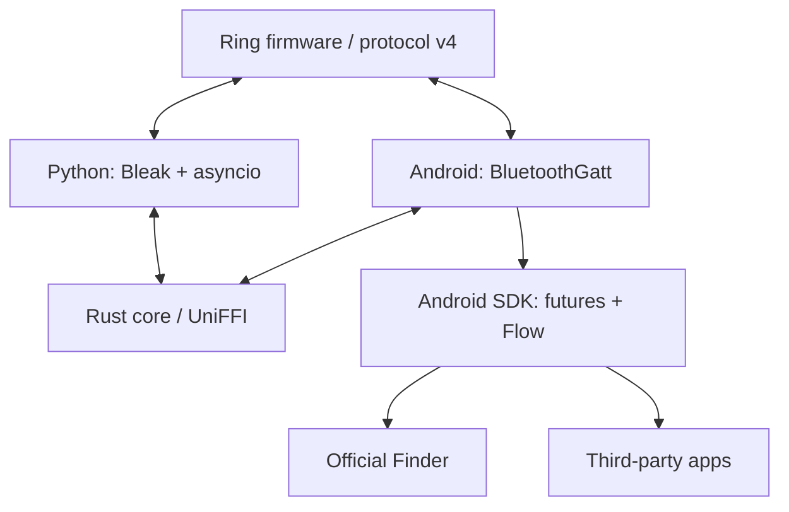

# libopenzilo

[中文](README.zh-CN.md) · MPL-2.0 · Rust core, Python binding, Android SDK

A local shared implementation of OpenZilo protocol v4. The Python SDK and the
Android Finder app use this core. Third-party Android apps can use `openzilo-sdk`
without depending on either application.

## Repository and artifacts

| Part | Name / location | Responsibility |
| --- | --- | --- |
| Rust crate and native Python package | `libopenzilo`, `src/` | Protocol, state machines, validation and portable algorithms |
| Generated Kotlin bindings | `com.zilo.libopenzilo` | UniFFI calls into the same Rust implementation |
| Android SDK | `com.zilo:openzilo-sdk`, `android/sdk/` | GATT, OS clocks, Future/Flow and connection/resource management |
| Consumer example | `android/sample/` | Minimal integration, without official app business logic |

The Android SDK and Rust crate are built and packaged separately. Android classes
are absent from Python wheels and desktop native libraries. The Bleak/asyncio SDK
and CLI remain in OpenZilo; Finder UI, pairing and OS ranging acquisition remain
in the application. The current local checkout is still named `OpenZiloCore/`;
the repository and package are named `libopenzilo`.



The core handles framing/CRC, capability admission, recording state and request
recovery, normal/fast downloads and bounded sink transfers, live validation,
IMU conversion/calibration and portable profiles, OP2C/Ogg/WAV export,
distance validity, signed firmware bundles and OTA state.
The Android SDK supplies serialized GATT writes, async requests, bounded events,
cancellation, disconnect cleanup and high-level device operations.

BLE discovery/permissions, OS connection policy, audio decoding/playback, Android
Channel Sounding acquisition belongs to its platform adapter.
The library does not enable CS on unsupported hardware or provide a direct
angle measurement. Finder displays distance and quality through Android Ranging;
it does not estimate direction or position.
No public PPG interface is provided.

## Build

Use the system package manager for JDK 21, the Android SDK manager for packages
under `~/Android/Sdk`, the project Gradle Wrapper for Gradle, and
`uv tool install maturin` for the Python build tool. Gradle caches belong in
`~/.gradle`; Rust uses its ordinary Cargo home and the project `target/` directory.

Requirements: Rust stable, Python 3.10+, JDK 21, Android SDK 36 / Build Tools
36.0.0, NDK r28c or a compatible newer NDK. Gradle uses 8.13, AGP 8.13.0,
Kotlin 2.2.21. Dependencies are pinned by `Cargo.lock` and the Android build files.

```sh
cargo test --locked
maturin build --release --out dist
rustup target add aarch64-linux-android
export JAVA_HOME=/usr/lib/jvm/java-21-openjdk # Linux / Arch example
export ANDROID_HOME="$HOME/Android/Sdk"
export ANDROID_NDK_HOME="$ANDROID_HOME/ndk/28.2.13676358"
cd android
./gradlew :sdk:testDebugUnitTest :sdk:assembleRelease :sample:assembleDebug
./gradlew :sdk:publishReleasePublicationToMavenRepository
```

`preBuild` builds the Rust library and generates Kotlin bindings. An installed
Gradle 8.13 can run the same commands. `tools/build_android.py --abi x86_64` or
`--abi armeabi-v7a` can build additional installed Rust targets; the default
artifact and sample ship **arm64-v8a only**, suitable for current physical phones.
To package several ABIs together, install their Rust targets and pass
`-PopenziloAbis=arm64-v8a,x86_64,armeabi-v7a` to Gradle. The `x86_64` ABI supports
Android emulator builds. CI builds that AAR and Linux x86_64, Windows x86_64 and
macOS arm64 wheels; those remote jobs must pass before claiming target support.

Outputs: Python wheel in `dist/`, SDK AAR in `android/sdk/build/outputs/aar/`,
example APK in `android/sample/build/outputs/apk/debug/`, and local Maven
repository in `dist/maven/`. The Maven publication includes dependency metadata
for JNA and Kotlin coroutines. A bare AAR alone does not embed these dependencies.
The Maven repository can be copied or hosted by the application developer.

## Use from Android

Add the generated Maven repository and dependency:

```kotlin
// settings.gradle.kts
// dependencyResolutionManagement.repositories {
//     maven { url = uri("/absolute/path/to/OpenZiloCore/dist/maven") }
//     google(); mavenCentral()
// }
// app/build.gradle.kts
// implementation("com.zilo:openzilo-sdk:0.1.0")

import com.zilo.sdk.OpenZiloDevice
import com.zilo.sdk.awaitResult

// Obtain BLUETOOTH_SCAN / BLUETOOTH_CONNECT permission on Android 12+.
// On Android 11 and earlier, BLE scanning needs location permission/services.
val ring = OpenZiloDevice.connect(context, bluetoothDevice).awaitResult()
try {
    val info = ring.getSystemInfo().awaitResult()
    val caps = ring.protocol.discoverCapabilities().awaitResult()
    val count = ring.protocol.audioCount().awaitResult()
    println("${info.model}: $count recordings")
} finally {
    ring.close()
}
```

Java uses `CompletableFuture`; Kotlin can use `awaitResult()` and `events()` Flow.
See [API and lifecycle](docs/api.md) and the standalone
[example app](android/sample/src/main/java/com/example/openzilo/MainActivity.kt).
No account, server, official app process, or production signing private key is
required for the SDK. The demo reads device information and capabilities.

## Use from Python

The existing `OpenZilo` SDK uses this sibling project for local uv development.
Its distribution declares `libopenzilo>=0.1.0,<0.2`; installed packages resolve
the published dependency without a sibling checkout. Existing public APIs remain
compatible, with additional sink downloads and distance replay:

```sh
cd ../OpenZilo
uv sync
uv run python -m unittest discover -s tests -v
```

Or install the wheel directly for transport-independent core APIs:

```python
import libopenzilo as core
wire = core.encode_packet(0x0101, b"")
assert core.decode_packet(wire).command == 0x0101
```

The wheel is native to its build OS/architecture. Build separate wheels on each
supported target before publishing; the current local build is Linux x86_64.
Publish and validate the core wheels before distributing the dependent SDK.
See [integration boundaries](docs/architecture.md) and [validation](docs/validation.md).

`library_info()` identifies the linked native core and its API contract/features.
No native PCM decoder is bundled: `decode_opus_pcm()` returns typed `Unavailable`.
Python retains its optional FFmpeg/PyAV backends. Ogg export preserves OP2C's
zero pre-skip convention; it cannot reconstruct missing encoder delay metadata.
